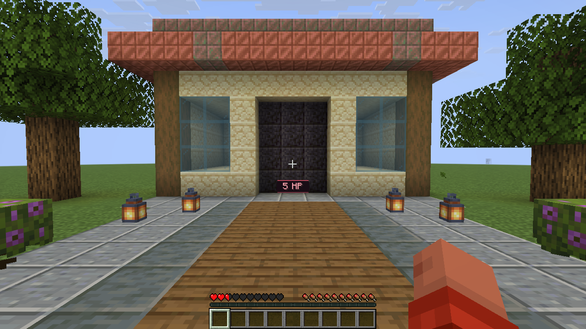
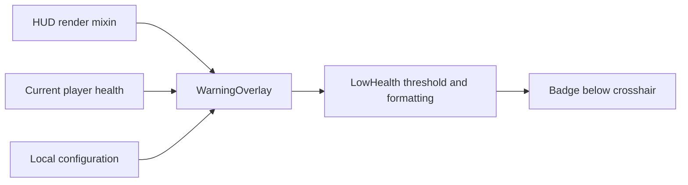

<div align="center">
<h1>Low HP Warning</h1>
<hr>
<p><strong>3 controls in one warning: current health, a configurable threshold, HUD visibility.</strong></p>
<p>


</p>
<p>
<a href="https://github.com/hhhhhffd/LowHPWarning/releases"></a>
<a href="https://github.com/hhhhhffd/LowHPWarning/releases"></a>
<a href="LICENSE"></a>
</p>
<p><a href="https://github.com/hhhhhffd/LowHPWarning/releases">Download</a> · <a href="#architecture">Architecture</a> · <a href="#build">Build</a></p>

</div>

## Overview

Low HP Warning is a client-side mod that shows a compact current-health badge below the crosshair, such as `7 HP` or `7.5 HP`. It uses current health, excluding yellow absorption hearts, and appears only below a configurable threshold.

## Technical Stack

| Component | Version / role |
| --- | --- |
| Minecraft Java | 1.21.11 |
| Fabric Loader | 0.18.4 or later |
| Java | 21 or later; build toolchain 21 |
| Fabric Loom / Gradle | 1.13.6 / 9.2.1 |
| Mod Menu | 17 or later, optional settings UI; compiled against 17.0.1 |

## Architecture



- **Current health only:** absorption is excluded; one red heart represents 2 HP.
- **Strict threshold:** the default is 10 HP, so 10 and 20 HP are hidden while 5 HP is shown.
- **HUD-aware rendering:** the badge is hidden in menus, spectator mode, when dead, and when F1 disables the HUD.

## Project Structure

```text
.
├── src/client/          # Health logic, settings, HUD and mixin
├── src/main/            # Fabric metadata and mixin declarations
├── tests/               # Standalone health logic checks
├── docs/media/          # In-game preview
├── build.gradle         # Loom build configuration
└── gradle.properties    # Minecraft and tool versions
```

## Install and configure

1. Install Java 21 or later and Fabric Loader 0.18.4 or later for Minecraft Java 1.21.11.
2. Place the [release JAR](https://github.com/hhhhhffd/LowHPWarning/releases) in the client `mods` folder. The mod is client-only and does not require Fabric API.
3. Optionally install Mod Menu 17 and open **Mods → Low HP Warning → Configure** to adjust the threshold or switch the warning off. Values from 0.01 to 1024 HP with up to two decimal places are accepted. Click **Done** to save.

Alternatively, edit `config/lowhpwarning.json` while Minecraft is closed:

```json
{
  "enabled": true,
  "threshold": 10.0
}
```

## Build

With Java 21, run `./gradlew build` (Windows: `gradlew.bat build`).

<details><summary>Standalone logic checks</summary>

```sh
javac -d build/health-tests src/client/java/com/lowhpwarning/LowHealth.java tests/LowHealthTest.java
java -cp build/health-tests LowHealthTest
```
</details>

## Links

- [Releases and downloads](https://github.com/hhhhhffd/LowHPWarning/releases)
- [Source repository](https://github.com/hhhhhffd/LowHPWarning)

## License

[MIT](LICENSE) © 2026 hhhhhffd.
